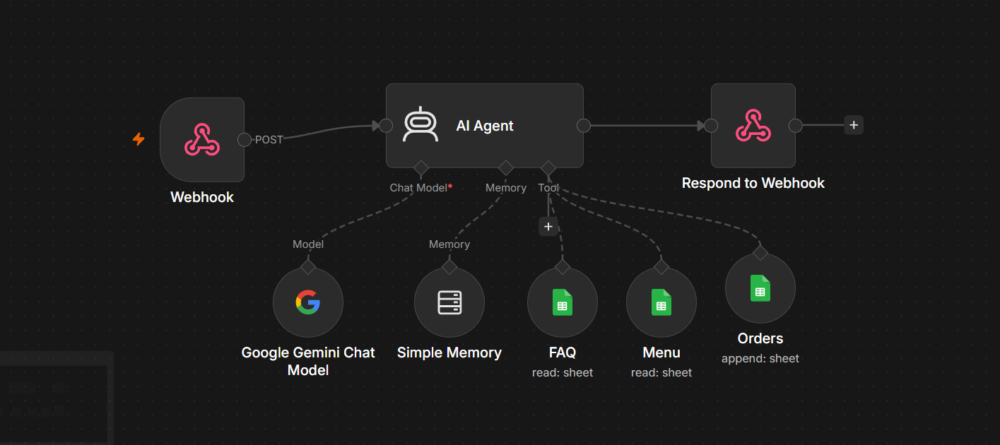

# 🤖 WhatsApp AI Cafe Receptionist

An AI-powered WhatsApp Cafe Receptionist that automatically responds to customer queries about cafe information, facilities, timings and food menus.

Built using **n8n, Google Gemini, WhatsApp Web.js and Google Sheets**, this project demonstrates how AI agents and workflow automation can improve customer communication.

## 🚀 Project Overview

The WhatsApp AI cafe Receptionist receives customer messages, processes them using an AI Agent in n8n and retrieves relevant information from Google Sheets.

It provides conversational responses to common cafe-related questions without requiring manual replies from staff.

## ✨ Features

- Automated WhatsApp message handling.
- AI-powered conversational responses using Google Gemini.
- Cafe FAQ lookup using Google Sheets.
- Food menu lookup using Google Sheets.
- n8n workflow automation.
- Session-based conversation handling.
- Webhook integration between WhatsApp and n8n.

## 🛠️ Tech Stack

| Technology | Purpose |
|---|---|
| n8n | Workflow automation |
| Google Gemini | AI-powered responses |
| WhatsApp Web.js | WhatsApp integration |
| JavaScript | Bot implementation |
| Node.js | Runtime environment |
| Google Sheets | FAQ and menu data |
| Webhooks | Communication between bot and n8n |

## ⚙️ How It Works

1. A customer sends a message through WhatsApp.
2. WhatsApp Web.js receives the incoming message.
3. The bot sends the message to an n8n Webhook.
4. The n8n AI Agent processes the customer's query.
5. Google Sheets tools provide relevant hotel FAQ or menu information.
6. Google Gemini generates a response based on the available information.
7. n8n returns the response to the WhatsApp bot.
8. The bot sends the reply to the customer.

## 📸 Project Screenshots

### n8n Workflow


### Google Sheet-Orders


### Wp Chats


## 💻 Local Setup

### Prerequisites

- Node.js installed.
- n8n installed and running locally.
- Google Gemini API key.
- WhatsApp account for testing.

### 1. Clone the Repository

```bash
git clone https://github.com/Sampatti15/n8n-WhatsApp_Automation.git
```

### 2. Open the Project Folder

```bash
cd n8n-WhatsApp_Automation
```

### 3. Install Dependencies

```bash
npm install
```

### 4. Configure n8n

- Import the provided `n8n-workflow.json`.
- Configure Google Gemini credentials.
- Connect your Google Sheets FAQ and Menu tools.
- Configure the Webhook path as `whatsapp-in`.
- Ensure the AI Agent and Respond to Webhook nodes are configured.

### 5. Run the WhatsApp Bot

```bash
node bot.js
```

Scan the QR code using WhatsApp → Linked Devices.

Keep n8n and the bot running while testing.

## ⚠️ Important Notes

- This project uses WhatsApp Web.js, an unofficial WhatsApp Web integration.
- It is intended for learning, experimentation and portfolio demonstration.
- It is not an official WhatsApp Business API integration.
- Unofficial integrations may disconnect or be restricted by WhatsApp.
- Do not use it for unsolicited bulk messaging or critical production communication.
- Keep API keys, WhatsApp session files and credentials private.
- This local demonstration requires the computer and n8n workflow to remain running.

## 🔮 Future Improvements

- Add cafe reservation management.
- Integrate a database for customer enquiries.
- Add human-agent handover.
- Deploy the automation on a cloud server.
- Explore official WhatsApp Business API integration.

## 👩‍💻 Author

**Sampatti Borse**

GitHub: https://github.com/Sampatti15

